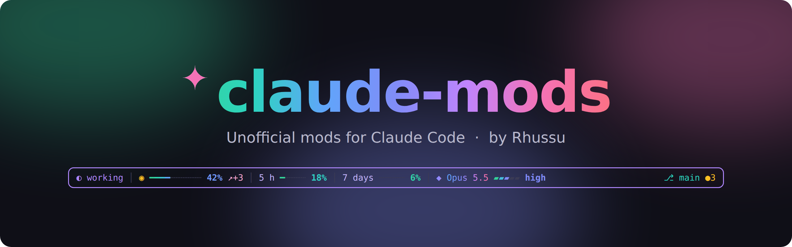

  

  
  
  
  
  
  

  Small, carefully built mods that change how <a href="https://claude.com/claude-code">Claude Code</a> looks and feels in your terminal.

---

## ✨ Mods

Each mod has its own page with **how to install it**, what it does, what it uses and how to remove it. 👉 **Click a mod to open it.**

<table>
  <tr>
    <td width="45%"></td>
    <td>
      <h3><a href="mods/aurorastate/README.md">aurorastate</a> <code>v0.1.0</code></h3>
      A colorful line above the prompt that shows, at a glance:
      <ul>
        <li>◐ whether Claude is <b>working</b> or it's <b>your turn</b></li>
        <li>◉ how full the <b>context</b> is, and its trend</li>
        <li>⏳ your <b>plan limits</b> (5 h · 7 days)</li>
        <li>◆ the <b>model</b> and its <b>effort</b></li>
        <li>⎇ your <b>git branch</b></li>
      </ul>
      🌐 English &amp; Spanish
        
      <a href="mods/aurorastate/README.md"><b>→ Install &amp; details</b></a>
    </td>
  </tr>
</table>

> [!WARNING]
> **Before you install any mod, from here or anywhere else:**
> - A mod runs **inside Claude Code with your user's permissions**. It is code on your machine, just like any other program you install.
> - Install mods only from **sources you trust**, and read what they do first. Every mod page here has a **🔒 Security at a glance** box and a **What it uses** section.
> - Claude Code always asks you to confirm a new marketplace. Make sure the source it shows is the one you expect.

> [!NOTE]
> Claude Code mods are an **early access** feature, and their API may change between releases. Each mod says which Claude Code version it was tested with.

## 🔒 Security

Every change reaches `main` only through a pull request that passes CI:

- ✅ **`claude plugin validate`** checks each mod and lists every hook it listens to and every engine call it makes.
- ✅ **Tests** for every mod.
- ✅ **[gitleaks](https://github.com/gitleaks/gitleaks)** scans for leaked secrets.
- ✅ Each mod documents what it uses, what it **doesn't** do, and its risks.

Found a problem? Please report it privately. See [SECURITY.md](SECURITY.md).

## 🤖 How it's made

This collection is **built and maintained by Claude**, Anthropic's AI, working through Claude Code:

- 💡 **Rhussu** comes up with the ideas, tries them out and decides what ships.
- 🛠️ **Claude** writes the code, the tests, the docs and the images, and publishes every change through a pull request that must pass CI.

These are mods for Rhussu's own setup, shared as they are. Ideas and bug reports are welcome in [Issues](https://github.com/Rhussu/claude-mods/issues).

## 📄 License

[MIT](LICENSE) © 2026 Rhussu. You can use, change and share these mods, even commercially, as long as you keep the copyright notice and the license.

Unofficial project. These mods are not reviewed or endorsed by Anthropic; being written by Claude doesn't make them an Anthropic product. "Claude" and "Claude Code" are trademarks of Anthropic.
