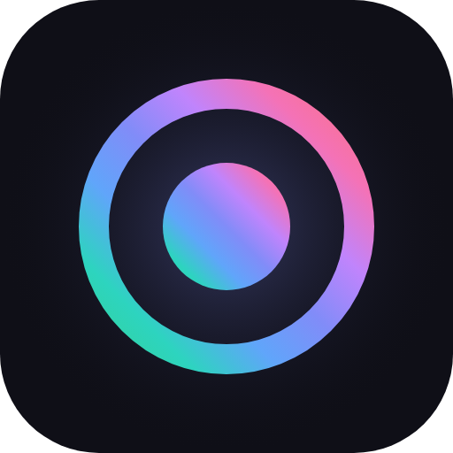
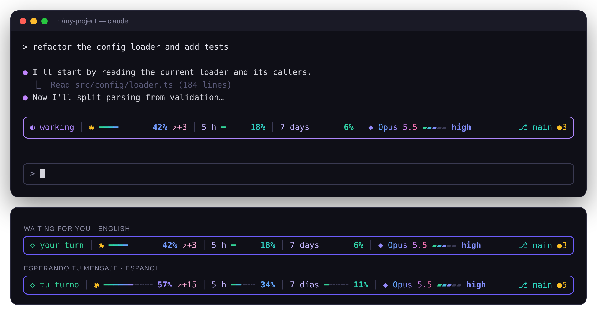

<p align="center">
  
</p>

<h1 align="center">aurorastate</h1>

<p align="center">
  
  <a href="../../LICENSE"></a>
  
  
</p>

<p align="center">
  A colorful line above the Claude Code prompt that shows, at a glance, what is going on in your session.
</p>

<p align="center">
  
</p>

## ✨ Features

| | |
|---|---|
| ◐ **State** | `working` while Claude answers (the spinner turns and the border cycles through the Aurora palette), `your turn` when it's waiting for you. |
| ◉ **Context** | How full the context window is, with its trend: `↗+3` as it grows, `↘` after a compaction. |
| ⏳ **Plan limits** | Your 5-hour and 7-day usage, when your account reports them. |
| ◆ **Model & effort** | The model name and the effort level as a 5-step meter, updated with every request. |
| ⎇ **Git** | The branch, on the right: `✓` when clean, `●N` for N changed files. |
| 📐 **Responsive** | On narrow terminals it drops parts in order: limit bars, the 7-day limit, git, then model. The state and the context always stay. |
| 🌐 **Bilingual** | English and Spanish. |

Bars fade from mint to pink as they fill, so you can read how full they are from the color alone.

## 🔒 Security at a glance

| | |
|---|---|
| ✅ | **No network access.** Nothing leaves your machine. |
| ✅ | **Writes no files.** |
| ✅ | **Never touches your tools, prompts or Claude's requests.** It only reads them, and never blocks or changes them. |
| ✅ | **Doesn't read your code, your messages or Claude's answers.** |
| ⚙️ | **Runs two read-only git commands**: `git rev-parse` and `git status`. |
| 👁️ | **Reads** usage figures, the model name, the effort level, two Claude Code settings and `$LANG`. |
| 👋 | **Says so the first time it runs**: a one-time notice explains what it reads and how to hide it. |

## 🚀 Install

```
/plugin install aurorastate --marketplace Rhussu/claude-mods
```

Answer `y` to add the marketplace, then pick a scope. See the [main README](../../README.md#-install) for updating and uninstalling.

The first time it runs, it shows a short notice:

```
✦ aurorastate is on · reads usage, model, effort & git status · no network, no file writes · Ctrl+X Ctrl+A hides it
```

## 🌐 Language

The `language` option sets the language of the line:

| Value | Language |
|---|---|
| `auto` *(default)* | Spanish if Claude Code's `language` setting or your system's `$LANG` is Spanish; English otherwise. |
| `en` | English |
| `es` | Spanish (Español) |

Set it in Claude Code's plugin settings, or when installing:

```bash
claude plugin install aurorastate --marketplace Rhussu/claude-mods --config language=es
```

## 🔍 What it uses

As reported by `claude plugin validate`.

<details open>
<summary><b>Events it listens to</b></summary>

| Event | Why |
|---|---|
| `session.start` / `session.end` | Start and stop its timers, pick the language, and show the one-time notice. |
| `session.measure` | Read the context, limits and cost figures Claude Code already computes. The cost is **ignored**. |
| `turn.start` / `turn.complete` | Start and stop the `working` animation. |
| `turn.step` | Read the effort level of each request. It **never changes** the request. |
| `ui.render` · `AbovePrompt` | Draw the line. |

</details>

<details open>
<summary><b>What it runs and reads</b></summary>

| What | When |
|---|---|
| `git rev-parse --abbrev-ref HEAD` and `git status --porcelain`, in the session's folder | After each answer and every 30 s, with a 5 s timeout. Claude Code runs git with the repository's hooks turned off. |
| Claude Code settings `effortLevel` and `language` | At session start. Read only. |
| The `LANG` environment variable | At session start, only when `language` is `auto`. |
| The model name and the session's usage figures | After each answer. |
| A plugin store key, `bienvenida` | At session start, to remember that the one-time notice was shown. |

</details>

## ⚠️ Risks and limitations

- **Early access API.** Claude Code mods may change between releases. Tested with Claude Code **2.1.314**.
- **Big repositories.** `git status` runs often. On a very large repository it can take a while; the 5 s timeout caps it.
- **Hidden during dialogs.** Claude Code draws permission dialogs on its own, so the line hides while one is open.
- **Needs 4 free rows** above the prompt. Otherwise it hides itself.
- **Light terminal themes.** The colors are designed for dark backgrounds.
- **Minimize button.** The `[-]` next to the line belongs to Claude Code and can't be removed. `Ctrl+X Ctrl+A` also toggles the line.

## 📄 License

[MIT](../../LICENSE) © 2026 Rhussu · [Changelog](CHANGELOG.md)
